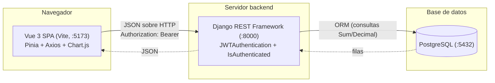
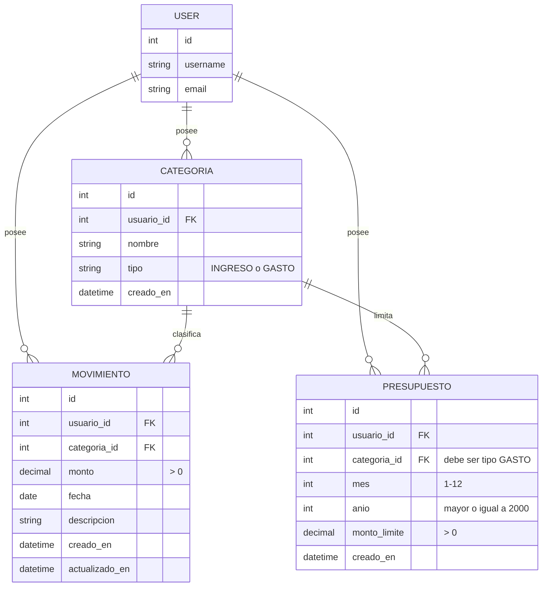
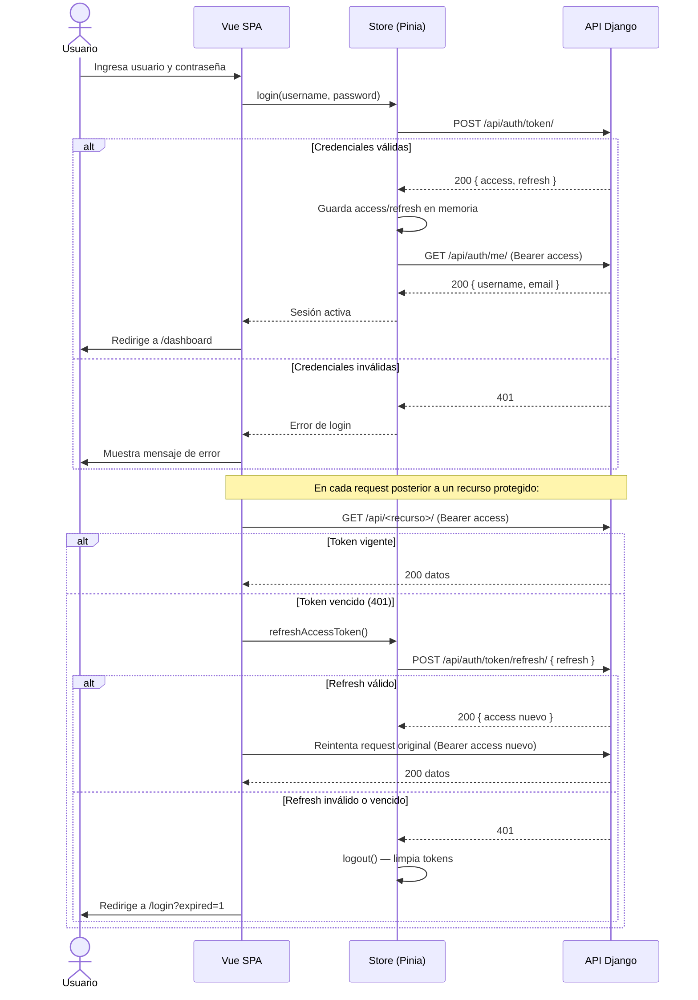
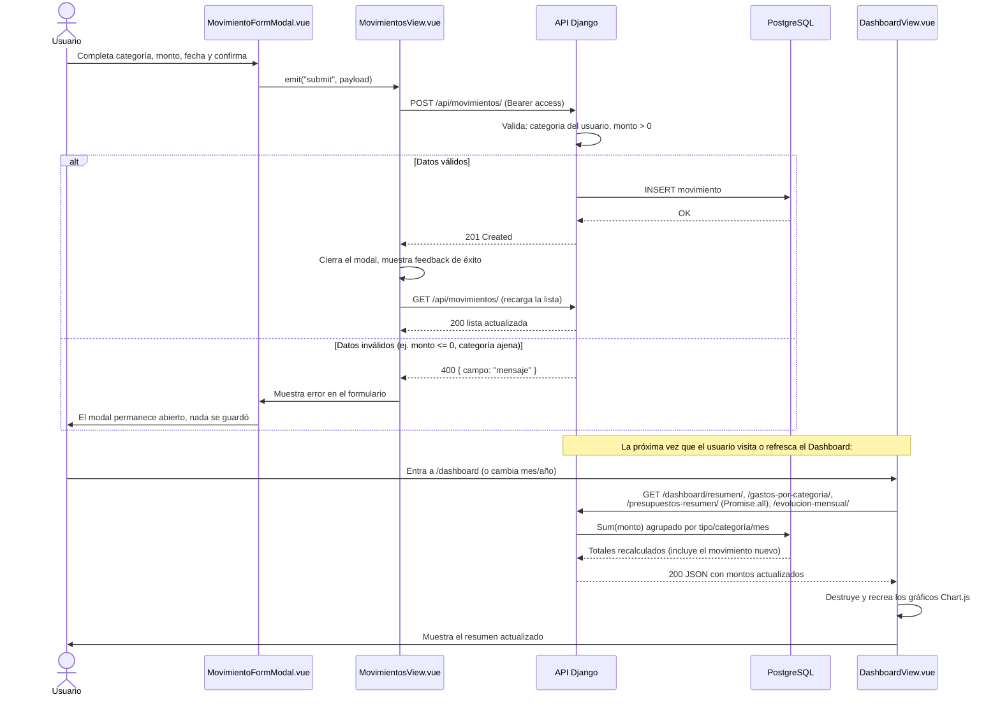

# Diagramas

Diagramas Mermaid del sistema, verificados contra la implementación real
(modelos, endpoints y componentes del repositorio al commit `93bc57a`).
Complementa a [DOCUMENTACION_TECNICA.md](DOCUMENTACION_TECNICA.md).

## Arquitectura general

## Entidad-relación

Restricciones de unicidad (no representables en el diagrama ER estándar):
`CATEGORIA` única por (`usuario`, `nombre`, `tipo`); `PRESUPUESTO` único
por (`usuario`, `categoria`, `mes`, `anio`).

## Flujo de autenticación

## Flujo de registro de un movimiento y actualización del dashboard

